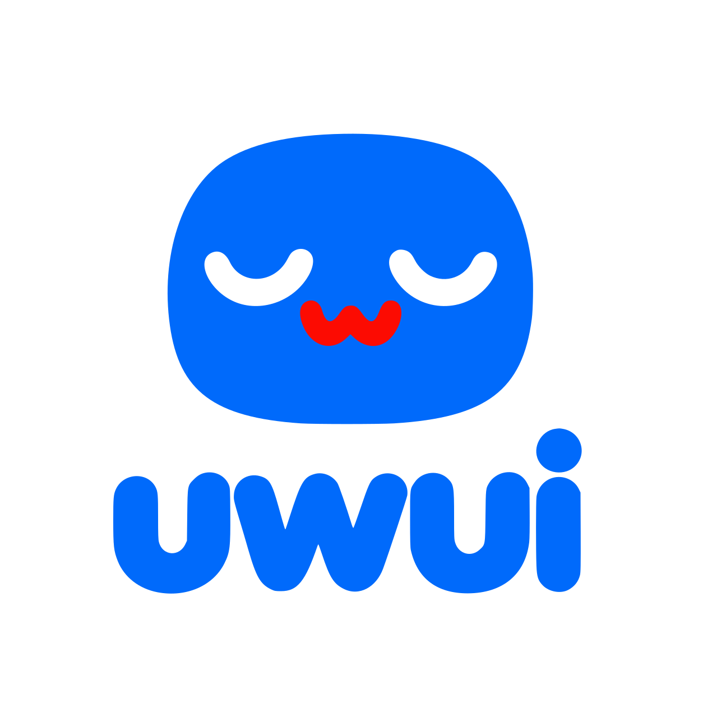

  

# uwui

uwui is SlimeEngine's UI framework, for the editor and for the interface of games
(`docs/adr/0132-the-engines-ui-framework.md`, `docs/adr/0179-the-framework-named-uwui.md`). It runs
without a GPU or a window: what it draws leaves it as data. Today it holds its text
(`docs/adr/0136-the-interfaces-text.md`), its display list
(`docs/adr/0139-text-drawn-and-the-display-list.md`), the tree of elements, their typed styles and
their layout (`docs/adr/0140-the-tree-of-elements.md`), and the style sheets and themes that style
them (`docs/adr/0141-style-sheets-and-themes.md`), the input and the focus
(`docs/adr/0142-input-and-focus.md`), what the tree means to agents
(`docs/adr/0143-what-agents-see-of-the-interface.md`), fields of text and of numbers
(`docs/adr/0145-text-edited.md`), what changed in the tree's meaning, which screen readers read
(`docs/adr/0146-screen-readers.md`), the widgets of a panel and the editor's look
(`docs/adr/0148-widgets.md`), and themes that compute their colors, transitions and the look's other
foundations (`docs/adr/0149-the-looks-foundations.md`).

Its logo is not under the code's licenses: its author keeps its rights, and
[`logo/README.md`](logo/README.md) says how it may be shown
([ADR-0183](../../docs/adr/0183-uwuis-logo.md)).

## Role

- `tree::Ui` is an interface: its roots, each named by a key and a surface of a size, a scale and
  a direction (`Ui::add_root`), and their trees of elements, kept from one frame to the next in an
  arena. `Ui::build` runs a builder
  when the revision that it reads moved, and matches the elements it adds with those before by their
  keys, so that their state and scroll survive; `Ui::frame` styles again the elements that changed,
  lays out by flexbox and grid the roots where something changed, mirrored for a root laid out from
  right to left, draws again what changed or moved, and gives the display list, with what it did
  (`FrameStats`): among it, the elements that its walks visited, which a frame costs even when
  nothing changed (`docs/adr/0186-counters-and-ratios-in-ci.md`). Its elements
  (`tree::Element`) are boxes, labels, parts of images, buttons, boxes that scroll, lists that build
  and lay out only the rows that show, and fields of text and of numbers, each with its classes.
- `theme::StyleSheet` holds rules that select elements by kind, classes, key, states and ancestor
  and set a part of their style, a document of KDL, read by the code that `uwui-macros`'s derives
  generate, each number of its field's measure, a length, a duration or a number, and a text named
  by a theme too; `theme::Theme` holds the named values that the rules give, a document of KDL whose
  groups give each value its kind, a color, a length, a duration, a number or a text, which may
  name each other and compute colors in OKLCH (`mix`, `lighten`, `darken`, `alpha`)
  (`docs/adr/0241-every-document-of-uwui-in-kdl-read-by-its-own-reader.md`). `Ui::set_style`
  styles an interface with them, its themes stacked, the last that gives a name giving its value,
  their errors each at its line, gathered (`DocumentErrors`)
  (`docs/adr/0149-the-looks-foundations.md`). A rule becomes a list of typed
  declarations, which the cascade applies to a `Style` without reflection; a rule for a kind sets
  only what that kind reads of a style
  (`docs/adr/0229-styles-typed-as-declarations.md`). An element's style starts from its kind's
  defaults, under every rule, which hold no color of their own: they take the core's seven
  *roles*, `canvas_text`, `accent` and the others, which each look gives and which fall back to
  the colors that an interface given no theme draws in
  (`docs/adr/0230-the-cores-roles-and-each-kinds-defaults.md`). An element's code writes its own
  style, `Element::style(|s| s.padding(12.0).hover(|s| ...))`, the declarations that it sets for
  its base and its states, with the place of the call (`style::OwnStyle`, `style::StyleBuilder`);
  the cascade takes it in the *mask order*: the rules in their order, then the own base where the
  last rule that set a field names no state, then the own states that hold. A hover or a press set
  in code offers no field that lays out
  (`docs/adr/0231-an-elements-own-style-written-in-code.md`).
- `theme::Token` names a theme's value in code, of one of four kinds, `Color`, `Length`,
  `Duration` and `Number`, with a fallback: `s.padding(SPACE).background(FACE)`. A crate lists its
  tokens (`theme::Tokens`) and a program declares each list once, `Ui::declare_tokens`;
  `Ui::set_style` reads each declared token in its kind, refuses a value of another kind, and gives
  a token that the themes lack its fallback, with one warning. The core's roles are tokens,
  `theme::ACCENT` and the others. Density and high contrast reach a token through the themes that
  give its name, never a number written in code
  (`docs/adr/0238-tokens-typed-named-in-code-declared-by-each-crate.md`).
- `preferences::Preferences` is what the user chose over every look, which a program gives with
  `Ui::set_preferences`: the size of text, a curve (`preferences::TextSize`), scales every text's
  size but icons', whoever wrote it, and a list's rows, whole in pixels of the screen; less motion
  ends transitions at once. Density and more contrast are not preferences: they choose the look's
  themes, which reach what code writes by the themes' names only, so that a length or a color that
  code writes as a number stays the author's
  (`docs/adr/0237-the-users-text-size-and-less-motion-density-and-contrast-by-names.md`).
- A style's `transition` moves a change of it over time: every color that the style holds, as
  `uwui-macros`'s derive lists them, and its opacity, elements that move alike sharing the style
  that they show (`docs/adr/0232-transitions-read-the-derives-colours-and-share-what-they-show.md`);
  and a section's height as it opens or folds, over the time that the program gives each frame
  (`Ui::advance`), which less motion drops (`Ui::set_preferences`); a frame says whether one goes on
  (`FrameStats::animating`), and a program that draws only when something changes reads whether the
  interface moves (`Ui::animating`) or needs the next frame for the rows of a list
  (`Ui::needs_frame`), and when it next changes on its own, a tooltip's rest or a
  notification's end (`Ui::next_change`). A style's paint holds an opacity, which its descendants share; the
  display list places boxes, images and clips on whole pixels of the screen; a text's style names
  OpenType features (`TextStyle::features`); an element focused by the keyboard, an agent or the
  program is in the state `FocusVisible`, one that the pointer focused is not.
- `Ui` takes a person's input, the pointer, the wheel, the modifiers and the keys in the types of
  `slime-input`, and turns it into `action::Action`s: a button pressed, an intent of navigation, the
  command of a shortcut. The program reads them from a queue (`Ui::take_actions`); an agent sends
  them (`Ui::act`). The interface moves the focus itself, by Tab in the order of the tree and by the
  arrows to the nearest element on screen, within its scope, and by F6 from one root to the next,
  and from one pane to the next within a root (`Element::pane`,
  [ADR-0172](../../docs/adr/0172-regions-of-tabs.md)); a
  focus that a press of the pointer gave to anything but a field leaves the keys to the program, and
  a game keeps Tab until its interface holds a focus (`Ui::set_tab_enters`,
  [ADR-0153](../../docs/adr/0153-tab-and-f6-in-a-games-interface.md)); a root may be a popup at a
  place of its own, or modal, keeping the input and the focus while it is open. An element's
  description, its tooltip, and whether a press opens a layer beside it, are part of what it means.
- `shortcuts::Shortcuts` is a table of shortcuts, read from a document: chords of the keys' meaning
  that name commands, in scopes, the classes of the elements around the focus; `Ui::set_shortcuts`
  takes them. A chord may name a button of the mouse, whose command the program reads,
  `Ui::button_command`, as the editor reads which button orbits its viewport
  (`docs/adr/0160-two-viewports-and-blenders-way.md`). Its errors are a `DocumentError`; the
  style sheets' and themes', `DocumentErrors`.
- A field (`Element::text_field`, `Element::text_area`, `Element::number_field`) keeps what the
  user types, selects with the keys and the pointer, undoes, copies and pastes through the clipboard
  that the program gives (`tree::Clipboard`, `Ui::set_clipboard`), which the program reads and
  writes too (`Ui::clipboard_text`, `Ui::set_clipboard_text`), and composes through an input
  method (`Ui::ime`); its text is laid out as a label's, parley moving its selection. The program
  reads it as actions, changed and committed (`action::FieldValue`), and the window asks it for
  the pointer's shape and where text is typed (`Ui::cursor`, `Ui::text_input`). The input calls
  give whether the interface took the event, which a game then leaves.
- A surface (`Element::surface`) shows an image that the program draws, an editor's viewport, and
  gives the program the pointer over it as actions (`action::SurfaceInput`): a button pressed over
  it holds the pointer until it is let go, and the keys without Control, Alt or Super reach the
  program meanwhile ([ADR-0158](../../docs/adr/0158-the-viewport.md)).
- Widgets, each an element kind that keeps its state in the tree: check boxes
  (`Element::check_box`) and sliders (`Element::slider`), whose values the program reads as
  actions, changed and committed (`action::FieldValue`), the program's value replacing the user's
  only when it changes; sections that fold what they hold (`Element::section`, `Ui::set_open`); bars
  of tabs (`Element::tab_bar`, `Element::tab`), whose choice runs again the builder that shows its
  panel (`Children::chosen`); two panels and the handle between them (`Element::split`); a
  splitter between two children of a box (`Element::splitter`), which holds no share of its own:
  the program reads the share that the user gives the first as actions and gives it back; and the
  scroll bars of a box that scrolls and of a list. Their parts apart from their box take the style's
  `control` part (`style::ControlStyle`), and rules select them by the states `Checked`, `Expanded`
  and `Selected`.
- `dock`, docking ([ADR-0172](../../docs/adr/0172-regions-of-tabs.md),
  [ADR-0174](../../docs/adr/0174-layouts-kept-floating-panels-and-closed-panels.md)): a program's
  panels laid out in a `dock::Layout`, splits of any number of children, each with its share,
  stacks of tabs, and panels that float, any of them closed and keeping its place; reflected data
  normalized after each edit, and fitted to the program's panels (`Layout::fit`). A `dock::Dock`
  builds it into the program's tree, each stack a pane of tabs over the chosen panel's slot, which
  the program fills (`Dock::slot`), a splitter between each two children of a split that show, and
  each floating panel in a floating layer; it takes its splitters' actions and its floating
  panels' places, reads the tabs chosen, moves a panel into another stack, to an edge of the window
  or afloat (`Dock::move_panel`), closes it and shows it again where it was (`Dock::close`,
  `Dock::show`), and tells the program when the layout settled (`Dock::take_changed`).
- Layers (`docs/adr/0150-layers.md`): roots over the others that the interface places
  (`Ui::open_layer`, `tree::Layer`, `tree::Place`), beside an element, at a point or floating, kept
  within the window, closed as the user leaves them, which the program reads
  (`action::ActionKind::Dismissed`); a modal layer's root, of the class `modal`, lays the backdrop
  that its style gives (`style::PaintStyle::backdrop`) over the window below it, which the editor's
  look dims (`docs/adr/0157-dialogs-the-cursor-held-and-the-gpus-identity.md`). Menus (`Element::menu`, `Element::menu_item`, `tree::ItemMark`)
  and a bar of menus (`Element::menu_bar`) that the keys move through, whose items' presses the
  program reads to open their submenus or do their commands; context menus that the pointer's second
  button and Shift+F10 ask for (`action::ActionKind::ContextMenu`); lists to choose from
  (`Element::choice`), which open their own list and give their choice as a value
  (`action::FieldValue::Chosen`, `Ui::chosen`); tooltips (`Element::tooltip`), shown once the
  pointer rests on the interface's clock; floating panels (`Element::floating_panel`), which move
  and size their layer (`Ui::layer_place`, `Ui::set_layer_place`), and tell the program where the
  pointer let them go (`action::ActionKind::Placed`). A style's `icons`
  (`style::Icons`) name the glyphs of a font that controls draw in place of their shapes.
- Rich fields (`docs/adr/0151-rich-widgets.md`): a field's placeholder (`Element::placeholder`),
  buttons that toggle (`Element::toggle_button`), controls of segments (`Element::segments`), bars
  of progress (`Element::progress`), a tab's count (`Element::counted_tab`), fields of search
  (`Element::search_field`), a field of numbers' prefix, which the pointer drags
  (`Element::prefix`), its units, which it converts as they are typed (`Element::units`,
  `tree::Units`), and the expressions that it reads; the box of a section's header
  (`Element::section_header`); tooltips of a title and a text (`Element::help`, `tree::Tooltip`).
- What the editor tells and finds (`docs/adr/0151-rich-widgets.md`): notifications stacked at
  the window's bottom end (`Ui::notify`, `tree::Notification`); the palette of commands, which
  finds a program's commands by name, scrolling past what the window's height holds, and gives the
  chosen one as a shortcut's command (`Ui::open_palette`, `tree::PaletteCommand`); the sheet of
  shortcuts
  (`Ui::open_shortcut_sheet`); a command's chord and the shortcuts by scope (`Ui::command_chord`,
  `Ui::shortcuts`).
- What the dev overlay's editors of reflected values need
  (`docs/adr/0152-the-dev-overlay-on-the-engines-interface.md`): sliders on a logarithmic scale and
  from high to low (`Element::logarithmic`, `Element::reversed`), options of a list to choose from
  that are disabled or carry help (`tree::ChoiceOption`), and fields of numbers that the program
  holds in an `f32` (`Element::single_precision`); color wells (`Element::color_well`), whose
  picker, a layer of their own, holds a square of saturation and value, strips of hue and alpha,
  the channels and the hexadecimal code, the program reading the color as a value
  (`action::FieldValue::Color`, `Ui::color`); boxes filled with a gradient in the display list
  (`display::GradientPrimitive`).
- `look`, built only with the feature `editor-look`, is the editor's look, made for the editor and
  the dev overlay, and drawn by the dev overlay (`slime-devui`) and the `widgets` example: its
  fonts, Geist and Geist Mono, and Lucide's icons (`look::register_fonts`, `look::icon`), its style
  sheet (`look::style_sheet`), and its themes, stacked: a base of scales, a theme of colors, dark,
  light or high contrast, and a compact one (`look::themes`, `look::Colors`, `look::Density`). Its
  files are in [`look/`](look/README.md), with the fonts' licenses, which a program that builds them
  in ships beside it.
- `Ui::meaning` says what the tree means, made when asked: each element drawn that means something,
  its `tree::Role`, named as AccessKit names roles, its name, its value, a field's, a slider's, two
  panels' or a splitter's share, a list to choose from's option, a color well's code or a bar of
  progress's share, its states, the `tree::ElementAction`s that an agent can do to it now, the part
  of it that shows and its path, the key of its root then its own keys, `editor/window/menus/File`,
  which `Ui::element_by_path` reads back; the interface's own layers are named `palette`,
  `shortcuts`, `tooltip`, `notifications`, `choices` and `colors`, and a key that an open root holds
  gets a variant, `menu-2` (`docs/adr/0156-the-editors-window-and-its-operations.md`). A box that
  only lays others out means nothing; a builder gives an element its role and its name
  (`Element::role`, `Element::named`), and an item of a tree its level and whether it opens
  (`Element::level`, `Element::expandable`, `docs/adr/0167-the-hierarchy.md`): a tree is a list
  whose rows its program flattens, given the role `Role::Tree`. `Ui::show_row` scrolls a list so
  that a row shows, by its number, built or not, and `Ui::scroll_into_view` scrolls the boxes around
  an element so that it shows, as the focus that the keys move is. `Ui::set_value` gives a field a
  value, as a person who replaced its text and committed would, and a slider, two panels, a
  splitter, a list to choose from or a color well theirs.
- An element made draggable (`Element::draggable`), pressed and moved past a few pixels, is
  dragged onto the elements made targets of drops (`Element::drop_target`): `Ui::dragging` says
  which target lies under the pointer and where in it, from its top to its bottom, which the program
  shows, and a release over it gives the target `ActionKind::Dropped`; Escape gives the drag up.
  Agents drop through `Ui::drop` (`docs/adr/0168-rearranging-the-hierarchy.md`).
- `Ui::take_meaning_changes` gives what changed in that meaning since it was last taken, as a
  screen reader's adapter sends it (`tree::MeaningChanges`): each element marked as its meaning
  changes, named by a number that no other element is ever given, with the elements that mean
  something nearest below it, and a field's text by runs, which screen readers move through by
  characters, words and lines (`Ui::field_runs`, `Ui::select_text`). `slime-app` translates them
  into AccessKit's tree.
- `style::Style` is an element's style, typed, in logical pixels: its layout, CSS's flexbox and
  grid properties with start and end sides, its paint, a box's fill, border, corners and shadow,
  and its text; a style sheet's rules set its parts through the declarations that
  `uwui-macros` derives, and the code that reads them.
- `text::Fonts` holds the fonts that text is laid out with: those registered from their bytes,
  named by their families in a style's stack, and the system's where a program asks for them, as
  the editor will, the font found for a writing system named for it from then on. A game draws
  with the fonts it ships, never the system's.
- `Fonts::lay_out` lays a text out in a `text::TextStyle` and a box, `text::TextBounds`: shaped,
  put in the order of its directions, broken into lines, aligned, and cut with an ellipsis when
  the box holds fewer lines than the text. The `text::TextLayout` gives its lines and its glyph
  runs, the cluster under a point, the position nearest it, carets and the rectangles of a
  selection.
- `text::GlyphRasterizer` draws a glyph's image, coverage or color, from the `text::GlyphKey` that
  a placed glyph carries: its face, size and position between two pixels.
- `text::TextCache` keeps laid-out text from one frame to the next within a budget of memory, and
  gives it shared, `Arc<TextLayout>`, so that a display list holds it without copying it.
- `display::DisplayList` is what an interface draws in a frame, as owned data: boxes, the shadows
  that boxes cast, boxes filled with a gradient, texts laid out and parts of images, which it names
  by keys (`display::ImageKey`) that the program drawing it resolves, each with its clip, its
  transform, the identity until uwui's first stage, and its layer, the root's until Stage 7.
  `uwui-render` draws it through the renderer's canvas.
- `Rect` is the rectangle the framework speaks in, by its top left corner and its size, as the
  renderer's canvas gives its own.

## Depends on

parley, fontique and swash, the text; taffy, the tree's flexbox and grid, run through its traits on
the tree's arena; their types stay inside the crate (`docs/adr/0132-the-engines-ui-framework.md`).
icu_properties, for the writing system of a character; `slime-color`, the colors of the styles and
the display list; `uwui-kdl`, the reader of its documents in KDL, its themes and style sheets
today; `slime-reflect` and `slime-serialize`, the styles described and the shortcuts read, until
M6d.3c; `uwui-macros`, the derives of the styles' declarations and of their readers
(`docs/adr/0229-styles-typed-as-declarations.md`); `slime-input`, the input it takes; thiserror and
tracing. No other engine
crate: text is laid out and rasterized on the CPU, `uwui-render` draws the display list, a
program reads the cooked documents, and the window's input reaches the interface through the
program.

## Must not

- Use a GPU, a window or the platform's events: the framework runs headless, in tests and on
  servers, and what it draws leaves it as data.
- Find a font by fallback where a stack can name it: the system's fallback costs up to a hundred
  times more than a font named (`docs/adr/0133-font-files-under-the-open-font-license.md`).
- Show parley's, fontique's, swash's or taffy's types in its API, nor depend on AccessKit:
  `slime-app` translates the tree's meaning into AccessKit's (`docs/adr/0146-screen-readers.md`).
